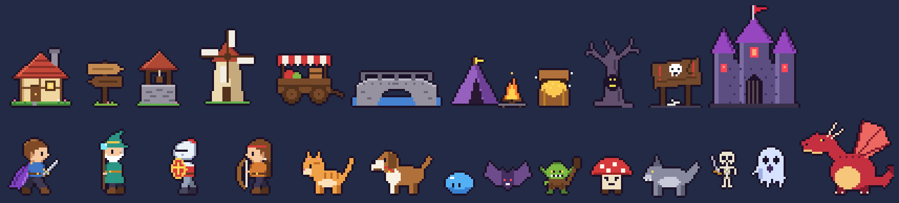
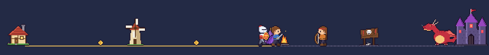
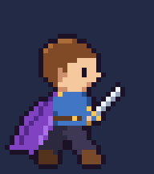

# my-progress-bar

An animated **pixel-art journey progress bar** for videos, packaged as a Claude Code skill and plugin.

A hero in a purple cape walks from a village house to an evil castle in step with the video's time.
At every milestone something happens: he passes places (well, windmill, bridge, camp, treasure chest…),
defeats enemies (slime, bat, goblin, wolf, skeleton, ghost…) and gains up to 3 partners (mage, knight,
archer, cat, dog) who follow him, until the final dragon fight in front of the castle.

- **22 components.** Each video gets its own story, chosen to fit the topic or picked at random within the story rules.
- **Up to 10 milestones.** Every 1 minute, or 2, 3, 5 or 10 for longer videos.





 · 30-second fast-forward demo: [docs/showcase-30s.mp4](docs/showcase-30s.mp4)

All sprites are drawn in code at their native size (about 30 px tall) and only scaled up by whole numbers, so they stay crisp at progress-bar size.

## Install

**As a plugin, in any project (Claude Code):**

```
/plugin install pixel-progress-bar --marketplace stevenfoong/my-progress-bar
```

On older versions, run `/plugin marketplace add stevenfoong/my-progress-bar` and then `/plugin install pixel-progress-bar@my-progress-bar`.

**In a session that has this repo:** Claude Code loads the skill from `.claude/skills/` automatically,
for example in a Claude Code on the web session with this repository attached.

Then just ask: *"add the pixel progress bar to video.mp4"*, *"make a 30-second showcase of the bar"*, or
*"export the progress bar as a transparent overlay for FilmCraft"*.

## Use without Claude

Requires Python 3, Pillow and ffmpeg.

```bash
S=skills/pixel-progress-bar/scripts
python3 $S/progressbar.py story --video video.mp4 --save plan.json     # pick + save the story
python3 $S/progressbar.py story --duration 501.8 --story well,bat,cat,camp,wolf,dog,warning_sign,dragon --save plan.json
python3 $S/progressbar.py detect video.mp4 --color '#d4ab58'           # find the line to walk on
python3 $S/progressbar.py still video.mp4 --plan plan.json --time 5 125 300 --out chk.png
python3 $S/progressbar.py burn video.mp4 --plan plan.json --out video-with-bar.mp4   # burned in, audio kept
python3 $S/progressbar.py overlay video.mp4 --out bar.mov              # ProRes 4444 with alpha, for editors
python3 $S/progressbar.py showcase --duration 501.8 --length 30 --out showcase.mp4
python3 $S/sprites.py sprites_out --scale 1 3 4                        # PNG and GIF sprites
```

Layout and story options (line position, scale, custom milestones) are described in
[skills/pixel-progress-bar/reference/config.md](skills/pixel-progress-bar/reference/config.md).

## Layout

```
.claude-plugin/          plugin + marketplace manifests
skills/pixel-progress-bar/
  SKILL.md               instructions Claude follows
  scripts/               progressbar.py, sprites.py
  presets/               magazine-1080p.json (layout of the original video template)
  reference/config.md    config keys, items, how to add sprites
.claude/skills/pixel-progress-bar -> ../../skills/pixel-progress-bar   (auto-load when working in this repo)
docs/                    previews
```

License: GPL-3.0.
